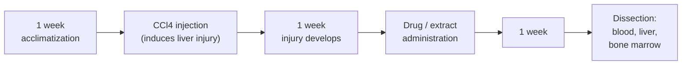

# In Vivo Hepatoprotective Study of Metadoxine, NAC, Neem and Burdock Root in CCl₄-Induced Liver Toxicity (Swiss Albino Mice)


B.Tech Biotechnology thesis, **Department of Biotechnology, Heritage Institute of Technology, Kolkata** (academic year 2024-25).
**Supervisor:** Dr. Riddhi Goswami (Associate Professor) | **Submitted:** 27 May 2025

**Team:** Anuska Sarkar, Indranil Ghosh, Noyonika Ghosh, Suprotim Dey, Abhradeep Mondal

---

## Table of contents

1. [Overview](#overview)
2. [Background](#background)
3. [Aim and objectives](#aim-and-objectives)
4. [Experimental design](#experimental-design)
5. [Methods](#methods)
6. [Results](#results)
7. [Discussion](#discussion)
8. [Data notes and limitations](#data-notes-and-limitations)
9. [Conclusion](#conclusion)
10. [Future scope](#future-scope)
11. [Skills demonstrated](#skills-demonstrated)
12. [Suggested repository structure](#suggested-repository-structure)
13. [References](#references)

---

## Overview

Carbon tetrachloride (CCl₄) is a classic experimental liver toxicant. This project asks whether two synthetic hepatoprotective drugs (**Metadoxine** and **N-acetylcysteine, NAC**) and two herbal extracts (**Neem**, *Azadirachta indica*, and **Burdock root**, *Arctium lappa*) can limit CCl₄-induced liver and cytogenetic damage in mice, how that protection changes with dose, and whether pairing a synthetic drug with an herbal extract helps.

Liver injury was assessed with four readouts:

| Readout | Sample | What it reports |
|---|---|---|
| Acid and alkaline phosphatase (ACP, ALP) | Liver homogenate | Tissue enzyme activity (PNPP substrate, 440 nm) |
| SGPT (ALT) | Serum | Hepatocellular leakage (Reitman-Frankel end-point assay) |
| SGOT (AST) | Serum | Hepatocellular leakage |
| Chromosomal aberration (pulverized chromosomes) | Bone marrow | Cytogenetic damage (Giemsa-stained slides) |

### Highlights

- CCl₄ raised serum SGPT and SGOT from **7 to 70 U/L** (10-fold) and raised pulverized chromosomes from **7% to 10%**.
- **Neem 0.2 g/kg** brought SGPT from 70 to **10 U/L** and ALP back to 0.05 U/mL (control 0.055).
- **NAC 600 mg/kg + Neem 0.2 g/kg** gave SGPT **10** and SGOT **12 U/L**.
- **Metadoxine 250 mg/kg + NAC 600 mg/kg** returned pulverized chromosomes to **7%**, equal to the untreated control.
- Most agents showed a **non-linear dose-response** for SGPT and chromosomes: a mid-range dose worked best, and the top dose did not add benefit.

---

## Background

**CCl₄ hepatotoxicity.** CCl₄ is not toxic by itself. Hepatic cytochrome P450 (mainly **CYP2E1**) converts it to the trichloromethyl radical (CCl₃•). At low oxygen tension CCl₃• binds covalently to cellular macromolecules and impairs lipid export from hepatocytes, which causes **steatosis**. At high oxygen tension it forms CCl₃OO•, which drives **lipid peroxidation**, membrane damage and cell death. Damaged hepatocytes leak ALT and AST into serum, so serum SGPT and SGOT rise.

**The agents tested**

| Agent | Class | Proposed hepatoprotective mechanism |
|---|---|---|
| Metadoxine (pyridoxine pidolate) | Synthetic | Preserves hepatic glutathione, limits lipid peroxidation and TNF-α, antifibrotic in stellate cells |
| NAC | Synthetic | Supplies cysteine for glutathione synthesis, scavenges free radicals |
| Neem leaf extract | Herbal | Antioxidant, stabilizes hepatocyte membranes (nimbolide among the active compounds) |
| Burdock root extract | Herbal | Antioxidant and anti-inflammatory (arctigenin, chlorogenic acid), limits lipid peroxidation |

---

## Aim and objectives

1. Establish the toxic effect of CCl₄ on the liver of Swiss albino mice.
2. Test the hepatoprotective effect of Metadoxine and of NAC against CCl₄.
3. Test the hepatoprotective effect of Neem and of Burdock root against CCl₄.
4. Characterize the dose-response of each agent.
5. Test combinations of one synthetic drug with one herbal extract (and Metadoxine with NAC).

---

## Experimental design

**Animals:** healthy male Swiss albino mice (*Mus musculus*) from a registered breeder (Ghosh Scientific, Kolkata), housed at 25 ± 1 °C on a 12 h light/dark cycle, fed a standard diet of ground pulses (sattu) with water *ad libitum*, and randomly divided into equal groups.



**Treatment groups**

| Group type | Treatments |
|---|---|
| Controls | Untreated control; CCl₄-only control |
| Metadoxine | 250, 500, 750 mg/kg |
| NAC | 300, 600, 750 mg/kg |
| Neem extract | 0.1, 0.2, 0.3 g/kg |
| Burdock root extract | 0.1, 0.2, 0.3 per mL water |
| Combinations | Metadoxine 250 mg/kg + NAC 600 mg/kg; Metadoxine + Burdock root 0.1 per mL; NAC 600 mg/kg + Neem 0.2 g/kg |

---

## Methods

### Preparation of extracts

- **Neem:** leaves oven-dried 1–2 h, then air-dried 24 h until crisp. Dry weight recorded, leaves soaked in ethanol, ethanol evaporated by heating, and the residue weighed per dose and suspended in edible vegetable oil.
- **Burdock root:** commercial extract (Tonga Herbs) dissolved in water at the required dose.

### 1. Total acid and alkaline phosphatase activity

**Principle.** Phosphatases hydrolyze *p*-nitrophenyl phosphate (PNPP) to *p*-nitrophenol (PNP), which is yellow under alkaline conditions and absorbs at 440 nm. Acid phosphatase is assayed at pH 5 (0.1 M acetate buffer) and alkaline phosphatase at pH 9 (0.1 M glycine-NaOH buffer), because each enzyme has its optimum at a different pH. The method follows Bergmeyer et al. (1974) with minor modifications.

**Procedure**

1. Mice were euthanized (chloroform), the liver dissected, weighed and split between the acid and alkaline buffers.
2. Liver homogenized in buffer (0.24 g fresh tissue/mL), kept on ice, centrifuged at 5000 rpm for 5 min; the supernatant was the liver homogenate.
3. Assay mixture: 0.4 mL buffer + 0.5 mL PNPP + 0.1 mL homogenate, incubated at 37 °C for 15 min, then stopped with 4 mL of 1 N NaOH (which also develops the yellow colour). In the control tube NaOH was added before incubation.
4. Absorbance read at 440 nm; activity read from a **PNP standard curve**. Units: 1 U = 1 µg PNP/min.

### 2. SGPT (ALT) and SGOT (AST) in serum

- Blood taken by cardiac puncture after sacrifice, centrifuged at 5000 rpm for 5 min, serum stored at 2 °C.
- **Reitman-Frankel end-point colorimetric method** (ARKRAY GPT/ALT 2,4-DNPH kit; an SGOT kit is also listed in the materials). ALT transfers an amino group from L-alanine to α-ketoglutarate, giving pyruvate and glutamate. Pyruvate reacts with 2,4-dinitrophenylhydrazine to form a brown hydrazone in alkali, and colour intensity is proportional to enzyme activity.
- Activity is calculated from (A_test − A_control) / (A_standard − A_reagent blank) against the kit's pyruvate standard (150 IU/L); reported in U/L.

### 3. Chromosomal aberration (bone marrow)

1. Femur dissected, marrow flushed into 0.01 M KCl (hypotonic solution that swells the cells and spreads the chromosomes), incubated at 37 °C for 20 min.
2. Centrifuged, pellet fixed in chilled aceto-methanol, held overnight.
3. Cell suspension dropped onto chilled 50% alcohol-soaked slides, flame-dried, stained with Giemsa for 45 min.
4. Observed at 10×, 40× and 100× and scored as normal or pulverized chromosomes.

---

## Results

Control = untreated mice. Values are as reported in the thesis; ± is shown where the thesis gives it.

### PNP standard curve (A440)

| PNP (mg) | 0.0 | 0.2 | 0.4 | 0.6 | 0.8 | 1.0 |
|---|---|---|---|---|---|---|
| Absorbance | 0 | 0.198 | 0.346 | 0.493 | 0.621 | 0.746 |

### Liver ALP activity (U/mL). Control 0.055; CCl₄ control 0.031 ± 0.02

| Agent | Low dose | Mid dose | High dose |
|---|---|---|---|
| Metadoxine (250 / 500 / 750 mg/kg) | 0.015 ± 0.001 | **0.050** | 0.03 ± 0.014 |
| NAC (300 / 600 / 750 mg/kg) | 0.0253 ± 0.027 | 0.0284 | 0.08 |
| Neem (0.1 / 0.2 / 0.3 g/kg) | 0.045 ± 0.0041 | **0.05 ± 0.00005** | 0.0236 |
| Burdock root (0.1 / 0.2 / 0.3 per mL) | 0.0377 ± 0.0174 | 0.01025 ± 0.011 | 0.02255 ± 0.026 |

### Liver ACP activity (U/mL). Control 0.048; CCl₄ control 0.05 ± 0.07

| Agent | Low dose | Mid dose | High dose |
|---|---|---|---|
| Metadoxine (250 / 500 / 750 mg/kg) | 0.0708 ± 0.0022 | 0.036 | 0.045 ± 0.007 |
| NAC (300 / 600 / 750 mg/kg) | 0.04347 | 0.030 | 0.055 ± 0.025 |
| Neem (0.1 / 0.2 / 0.3 g/kg) | 0.097 ± 0.0273 | 0.054 ± 0.001 | 0.00154 |
| Burdock root (0.1 / 0.2 / 0.3 per mL) | 0.045 ± 0.028 | 0.0645 ± 0.012 | 0.0232 ± 0.017 |

### Phosphatase activity, combination treatments (U/mL)

| Combination | ACP | ALP |
|---|---|---|
| Metadoxine + Burdock root | 0.066 ± 0.0526 | 0.0267 ± 0.0371 |
| NAC 600 mg/kg + Neem 0.2 g/kg | 0.101 ± 0.106 | 0.0425 ± 0.043 |
| Metadoxine 250 mg/kg + NAC 600 mg/kg | 0.045 | 0.02 |

### Serum SGPT and SGOT (U/L)

| Treatment | SGPT | SGOT |
|---|---|---|
| Control (no CCl₄) | 7 | 7 |
| **CCl₄ only** | **70** | **70** |
| Metadoxine 250 mg/kg | 60 | 65 |
| Metadoxine 500 mg/kg | 35 | 48 |
| Metadoxine 750 mg/kg | 45 | 32 |
| NAC 300 mg/kg | 55 | 57 |
| NAC 600 mg/kg | 30 | 48 |
| NAC 750 mg/kg | 45 | 28 |
| Neem 0.1 g/kg | 56 | 54 |
| **Neem 0.2 g/kg** | **10** | 30 |
| Neem 0.3 g/kg | 32 | **12** |
| Burdock root 0.1 /mL | 45 | 47 |
| Burdock root 0.2 /mL | 21 | 32 |
| Burdock root 0.3 /mL | 33 | 19 |
| Metadoxine 250 + NAC 600 | 18 | 26 |
| Metadoxine 250 + Burdock root 0.1 /mL | 17 | 15 |
| **NAC 600 + Neem 0.2** | **10** | **12** |

### Chromosomal aberration (pulverized chromosomes, % of cells scored)

Normal chromosomes were reported as 92% in every group. Control = 7%, CCl₄ only = 10%.

| Dose level | Metadoxine (mg/kg) | NAC (mg/kg) | Neem (g/kg) | Burdock root (per mL) |
|---|---|---|---|---|
| Low (250 / 300 / 0.1 / 0.1) | 7 | 8 | 8 | 7 |
| Mid (500 / 600 / 0.2 / 0.2) | **5** | 9 | **7** | 11 |
| High (750 / 750 / 0.3 / 0.3) | 11 | 10 | 10 | **6** |

| Combination | Pulverized (%) |
|---|---|
| Metadoxine 250 + Burdock root 0.1 /mL | 11 |
| NAC 600 + Neem 0.2 | 11 |
| **Metadoxine 250 + NAC 600** | **7** |

### Best-performing treatments by endpoint

| Endpoint | Best result | Reference values |
|---|---|---|
| SGPT | Neem 0.2 g/kg and NAC + Neem (both 10 U/L) | Control 7, CCl₄ 70 |
| SGOT | Neem 0.3 g/kg and NAC + Neem (both 12 U/L) | Control 7, CCl₄ 70 |
| ALP (single agents) | Metadoxine 500 mg/kg and Neem 0.2 g/kg (0.050) | Control 0.055, CCl₄ 0.031 |
| Chromosomes | Metadoxine + NAC (7%); Metadoxine 500 mg/kg (5%) | Control 7%, CCl₄ 10% |

---

## Discussion

**Dose-response is non-linear for most agents.** For SGPT, ALP and chromosomes the best effect came at a mid dose (Metadoxine 500, NAC 600, Neem 0.2) and the highest dose was no better or worse. A plausible reading (not tested here) is that protection saturates once the oxidative load is covered, while extra drug adds its own burden. Neem is the clearest case, with ACP falling to 0.00154 U/mL at the top dose, which may reflect toxicity or an assay artefact. SGOT behaved differently, falling steadily with dose for Metadoxine, NAC, Neem and Burdock root.

**Why these agents plausibly work.** CCl₄ damage is driven by CYP2E1-generated radicals and lipid peroxidation, and both NAC (cysteine for glutathione synthesis) and Metadoxine (glutathione preservation) support the cell's main radical-detoxifying pool. Neem and Burdock root contribute polyphenol and lignan antioxidants. The combination of Neem or Burdock root with a glutathione-supporting drug gave the lowest SGPT and SGOT values, consistent with attacking oxidative injury from two directions. This remains a hypothesis, because no glutathione or lipid-peroxidation marker was measured.

**Why serum enzymes and tissue enzymes move in opposite directions.** When hepatocytes are injured, ALT and AST leak into blood, so serum values rise (7 to 70 U/L here). The enzyme content of the damaged liver tissue falls, which fits the lower ALP in the CCl₄ homogenate (0.031 vs 0.055 U/mL). Serum SGPT/SGOT are therefore the more direct injury readout in this study.

**Combination therapy.** The thesis frames the herbal-plus-drug design on precedents such as piperine with rifampicin and silymarin with chemotherapy. Here NAC + Neem gave the best serum-enzyme result, and Metadoxine + NAC gave the best chromosomal result.

---

## Data notes and limitations

These points come from re-reading the thesis tables and are worth stating openly in a public repository.

- **Sample size and statistics:** the number of mice per group, the number of cells scored for chromosomes, and statistical tests (p-values) are not reported, and SGPT/SGOT and chromosome values have no error bars. "Best dose" is judged by closeness to the control value, not by a statistical test.
- **ACP is not informative:** CCl₄ did not change liver ACP (0.05 vs 0.048 U/mL), so ACP cannot discriminate protective from non-protective treatments.
- **Direction of the phosphatase change:** the discussion describes elevated phosphatases after CCl₄, but the data show ALP *decreased* (0.031 vs 0.055) and ACP was unchanged. The conclusion ("reduced enzyme activity") matches the data.
- **ALP in combination groups:** the ALP table lists the CCl₄ control as 0.05 ± 0.07 (the ACP value) instead of 0.031 ± 0.02, apparently a copy error. Metadoxine + NAC gave ALP 0.02, below CCl₄ alone, so the statement that this pair "fully restored" enzyme levels holds for SGPT/SGOT and chromosomes but not for ALP.
- **Chromosome effect size:** the CCl₄ group differs from control by 3 percentage points (10% vs 7%), and the normal-chromosome fraction was reported as 92% in every group, so the readout has limited dynamic range. The text calls 250 mg/kg Metadoxine the best dose, while the table shows 500 mg/kg at 5%.
- **Combination doses are inconsistent:** the phosphatase table gives Metadoxine 500 mg/kg + Burdock root, whereas the SGPT, SGOT and chromosome tables give Metadoxine 250 mg/kg + Burdock root.
- **Dose labels:** the methods list Neem at 0.1/0.2/0.4 g but results use 0.1/0.2/0.3 g/kg. Burdock root is expressed as "per mL water" with the extract concentration unspecified.
- **Route of administration:** the methods state oral dosing, while the cytogenetics annexure mentions intraperitoneal injection.
- **Single time point and endpoints:** one dosing window and one dissection time; no histopathology, glutathione or lipid peroxidation (MDA) measurements.
- **CCl₄ dose:** given as "5 units" in the methods; the literature section describes 0.25 mL of 10% CCl₄.

---

## Conclusion

CCl₄ produced clear biochemical liver injury (SGPT and SGOT up 10-fold) and a modest rise in chromosomal damage. Moderate doses of Metadoxine (500 mg/kg), NAC (600 mg/kg) and Neem (0.2 g/kg) were the most effective single treatments, while the highest doses added no benefit, indicating non-linear dose-response. Among combinations, NAC + Neem gave the lowest serum enzymes (SGPT 10, SGOT 12 U/L) and Metadoxine + NAC restored chromosomal stability to the control level (7%). Dose optimization and careful pairing matter more than escalating dose.

## Future scope

- Finer dose-ranging for each agent and for combinations, with isobologram or combination-index analysis to test true synergy.
- Mechanistic markers: glutathione, MDA, antioxidant enzymes, and CYP2E1 activity.
- Histopathology of liver sections, plus the comet assay for DNA damage.
- Comparison against a standard hepatoprotective such as silymarin, and against NAC alone as the clinical benchmark.
- Chronic-exposure safety studies, other toxic-injury models, and formulation work (nanoparticles, liposomes) to improve bioavailability of the herbal extracts.

---

## Skills demonstrated

Animal handling and dosing, liver homogenization and serum separation, spectrophotometric enzyme assays (PNPP/PNP standard curve), serum biochemistry (SGPT/SGOT), cytogenetics (bone-marrow chromosome preparation, Giemsa staining, microscopy), plant-extract preparation, dose-response analysis and critical review of experimental data.

---

## Suggested repository structure

```
invivo-ccl4-hepatoprotection/
├── README.md
├── data/
│   ├── pnp_standard_curve.csv
│   ├── phosphatase_acp_alp.csv
│   ├── sgpt_sgot.csv
│   └── chromosomal_aberration.csv
├── figures/
│   ├── pnp_standard_curve.png
│   ├── alp_by_agent.png
│   ├── sgpt_sgot_bar.png
│   └── bone_marrow_chromosomes_40x.png
├── thesis/
│   └── In_vivo_studies_of_Metadoxine_NAC_Neem_Burdock_Root.pdf
└── LICENSE
```

## References

Sources as cited in the thesis (full details are in the thesis PDF):

1. Higuera-de la Tijera F. et al. (2014, 2015). Metadoxine in alcoholic liver disease.
2. Sahasrabudhe S. et al. (2023). N-acetylcysteine.
3. Alzohairy M. A. (2016). *Azadirachta indica* (Neem).
4. Sheng W. et al. (2023). *Arctium lappa* (burdock root).
5. Teschke R. (2018) and Weber L. W. (2001). CCl₄ hepatotoxicity.
6. Bergmeyer H. U. et al. (1974). Phosphatase assay method.
7. Reitman S. and Frankel S. (1957). Colorimetric transaminase (SGPT/SGOT) method.
8. Badmaev V. et al. (1999); Kren V. and Walterova D. (2005). Herbal-plus-drug combination precedents.

*B.Tech thesis, Heritage Institute of Technology, 2025. For academic and portfolio use.*
